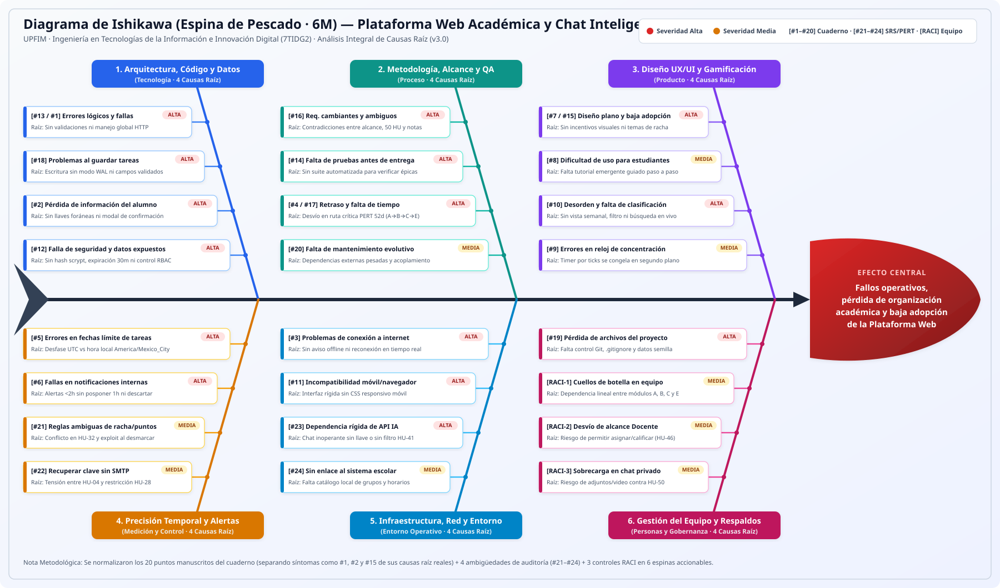

# Análisis Causa–Efecto (Diagrama de Ishikawa v3.0)

**Proyecto:** Plataforma Web Académica de Gestión de Tareas, Racha de Cumplimiento y Chat Inteligente  
**Institución:** Universidad Politécnica de Francisco I. Madero (UPFIM) · 7TIDG2  
**Versión:** 3.0 (6 Espinas Maestras 6M × 24 Causas Raíz + Análisis 5 Porqués + Matriz de Riesgo)

---

## 1. Planteamiento del Problema Central (Cabeza del Pez)

> **Efecto Central:** *Fallos operativos, pérdida de organización académica y baja adopción de la Plataforma Web.*

### Mejoras metodológicas aplicadas respecto al borrador manuscrito
1. **Separación estricta entre Síntomas y Causas Raíz:** El borrador original (`WhatsApp Image 2026-11-21 at 12.31.12.jpeg` y `12.31.24.jpeg`) mezclaba síntomas finales (`#1 Fallas en el sistema`, `#2 Pérdida de información`, `#15 Poca participación`) con causas técnicas (`#13 Errores de programación`, `#14 Falta de pruebas`). En v3.0 cada uno aparece enlazado a su **subcausa raíz de segundo nivel**.
2. **Clasificación 6M Completa (24 nodos visibles en el diagrama):** Se integran los **20 puntos base** del cuaderno, **4 ambigüedades detectadas durante la auditoría SRS/PERT** (`#21`–`#24`) y **3 controles de gobernanza RACI** (`RACI-1`–`RACI-3`).
3. **Priorización por Severidad:** Cada causa raíz cuenta con clasificación **ALTA** o **MEDIA**, análisis **5 Porqués** y vínculo directo con el archivo donde quedó mitigada en el código.

---

## 2. Diagrama Vectorial Completo (Espina de Pescado 6M)

> Versión interactiva con inspector de **5 Porqués**, filtros y exportación a **SVG / PNG / PDF**: [diagrama-ishikawa.html](./diagrama-ishikawa.html) (también accesible directamente en la app en ejecución en `http://localhost:3000/ishikawa`).

---

## 3. Análisis de Causa Raíz (Método de los 5 Porqués por Categoría)

| Categoría 6M | Problema Observable | 5 Porqués (Cadena Causal hasta la Raíz) | Contramedida Implementada en Código |
| :--- | :--- | :--- | :--- |
| **1. Arquitectura, Código y Datos** | Fallos al guardar tareas, pérdida de registros y riesgo de seguridad (`#1, #2, #12, #13, #18`) | ¿Por qué fallaba al guardar o perdía datos? → No había esquema relacional transaccional ni validaciones estrictas → ¿Por qué? → Faltaban llaves foráneas, modo WAL, hash de contraseñas y control de acceso por rol. | SQLite en modo `WAL` + `PRAGMA foreign_keys = ON` en `server/db.js`; hash `scrypt` + expiración 30 min + RBAC en `server/auth.js` y `server/index.js`. |
| **2. Metodología, Alcance y QA** | Retraso en el desarrollo, cambios de alcance y errores en producción (`#4, #14, #16, #17, #20`) | ¿Por qué se retrasaba o salía con defectos? → Los requisitos tenían ambigüedades sin resolver y no existían pruebas automatizadas → ¿Por qué? → Se redactaron los insumos por separado sin desambiguación ni suite de regresión. | Desambiguación técnica documentada en `documentacion/README.md`, arquitectura modular alineada a la EDT y suite `tests/platform.test.js` (`npm test`). |
| **3. Diseño UX/UI y Gamificación** | Baja participación de estudiantes, desorden y deriva del reloj (`#7, #8, #9, #10, #15`) | ¿Por qué los estudiantes abandonaban la web? → La interfaz era poco guiada, las tareas se amontonaban y el temporizador fallaba → ¿Por qué? → Faltaba onboarding interactivo, filtros/vistas y reloj basado en marca de tiempo real. | Tablero Lunes–Domingo + Vista Diaria + Historial (`public/js/student.js`), Tutorial interactivo (`public/js/tutorial.js`), 6 Temas de Racha (`public/js/streak.js`) y Pomodoro `targetEndMs` (`public/js/timer.js`). |
| **4. Precisión Temporal y Alertas** | Fechas límite erróneas, alertas perdidas y conflicto en rachas/recuperación (`#5, #6, #21, #22`) | ¿Por qué vencían tareas antes de tiempo o no llegaban avisos? → El servidor comparaba en UTC y no existía lógica de posponer/descartar ni reglas anti-exploit → ¿Por qué? → No se había normalizado la zona horaria del cliente ni la persistencia de notificaciones. | `X-Client-Timezone` (`America/Mexico_City`) en `server/db.js`, alertas `<2h` con `Posponer 1 hr` / `Entendido` (`public/js/notifications.js`), algoritmo anti-exploit (`server/streak.js`) y bandeja local de recuperación. |
| **5. Infraestructura, Red y Entorno** | Bloqueos por internet, fallos en móvil y dependencia de API externa (`#3, #11, #23, #24`) | ¿Por qué quedaba inutilizable en móvil o sin API externa? → La UI no era responsiva, la IA dependía de llave obligatoria y no había catálogo académico local → ¿Por qué? → Se asumió escritorio fijo e integración externa inexistente. | CSS Grid/Flexbox responsivo (`public/css/styles.css`), banner `offline` (`public/js/app.js`), motor híbrido IA con guardrail (`server/assistant.js`) y catálogo local en `server/seed.js`. |
| **6. Gestión del Equipo y Respaldos** | Pérdida de archivos del proyecto y desalineación de roles (`#19, RACI-1..3`) | ¿Por qué podían perderse avances o invadir el alcance docente/chat? → Faltaba control de versiones, semilla reproducible y candados de alcance → ¿Por qué? → No se habían fijado límites en backend ni `.gitignore`. | `.gitignore`, semilla automática en `server/seed.js`, bloqueo `403` a docentes en rutas de alumnos (`HU-46`) y bloqueo `400` a adjuntos en chat (`HU-50`) en `server/index.js`. |

---

## 4. Matriz Completa de Trazabilidad y Riesgos (24 Ítems)

| Ref. | Título / Descripción | Categoría 6M | Severidad | Historias (HU) | Solución en el Proyecto |
| :-: | :--- | :--- | :---: | :--- | :--- |
| **#1 / #13** | Errores lógicos y fallas del sistema | 1. Arquitectura y Datos | **ALTA** | HU-01..HU-50 | Manejo global de errores HTTP/JSON y validaciones en `server/index.js`. |
| **#18** | Problemas al guardar tareas | 1. Arquitectura y Datos | **ALTA** | HU-11, HU-12 | Validación visual de campos obligatorios y persistencia inmediata en SQLite. |
| **#2** | Pérdida de información del alumno | 1. Arquitectura y Datos | **ALTA** | HU-03, HU-14 | SQLite WAL, llaves foráneas `ON DELETE CASCADE` y modal de confirmación. |
| **#12** | Falla de seguridad y datos expuestos | 1. Arquitectura y Datos | **ALTA** | HU-01, HU-02, HU-06 | Hash `scrypt` + salt, expiración por inactividad (30m) y control RBAC. |
| **#16** | Requisitos cambiantes y ambiguos | 2. Metodología y QA | **ALTA** | Todas | Desambiguación explícita de horarios, tokens, rachas y alcance IA. |
| **#14** | Falta de pruebas antes de entrega | 2. Metodología y QA | **ALTA** | Todas | Suite automatizada `tests/platform.test.js` (`npm test`). |
| **#4 / #17** | Retraso y falta de tiempo (PERT 52d) | 2. Metodología y QA | **ALTA** | Ruta A→B→C→E | Arquitectura modular sin dependencias externas para acelerar entrega. |
| **#20** | Falta de mantenimiento evolutivo | 2. Metodología y QA | **MEDIA** | — | Separación clara por módulos (`server/*.js` y `public/js/*.js`). |
| **#7 / #15** | Diseño plano y baja adopción | 3. Diseño UX/UI | **ALTA** | HU-34..HU-37 | Interfaz moderna responsiva y 6 temas visuales desbloqueables con vista previa. |
| **#8** | Dificultad de uso para estudiantes | 3. Diseño UX/UI | **MEDIA** | HU-07..HU-10 | Tutorial interactivo emergente al primer inicio y botón `Ver tutorial`. |
| **#10** | Desorden y falta de clasificación | 3. Diseño UX/UI | **ALTA** | HU-15..HU-24 | Tablero semanal 7 días, vista diaria, filtro por materia, búsqueda y orden. |
| **#9** | Errores en reloj de concentración | 3. Diseño UX/UI | **MEDIA** | Mejora UX | Temporizador Pomodoro basado en `targetEndMs` en `localStorage`. |
| **#5** | Errores en fechas límite de tareas | 4. Precisión Temporal | **ALTA** | HU-17 | Normalización `America/Mexico_City` y bloqueo de vencimientos pasados. |
| **#6** | Fallas en notificaciones internas | 4. Precisión Temporal | **ALTA** | HU-25..HU-28 | Alertas `<2h`, resumen al iniciar sesión, autocierre 10s y `Posponer 1 hr`. |
| **#21** | Reglas ambiguas de racha y puntos | 4. Precisión Temporal | **MEDIA** | HU-29..HU-33 | Reinicio a 1 día por inactividad y reversión exacta de `points_awarded`. |
| **#22** | Recuperar clave sin correo externo | 4. Precisión Temporal | **MEDIA** | HU-04 vs HU-28 | Token criptográfico 15 min mostrado en bandeja local segura sin SMTP. |
| **#3** | Problemas de conexión a internet | 5. Infraestructura y Red | **ALTA** | Limitación 2 | Banner de estado offline/online y reconexión SSE automática. |
| **#11** | Incompatibilidad móvil/navegador | 5. Infraestructura y Red | **ALTA** | Limitación 1 | CSS Grid/Flexbox responsivo adaptable a escritorio y móvil. |
| **#23** | Dependencia rígida de API de IA | 5. Infraestructura y Red | **ALTA** | HU-38..HU-42 | Motor híbrido funcional offline con guardrail estricto escolar (`HU-41`). |
| **#24** | Sin enlace al sistema escolar (ERP) | 5. Infraestructura y Red | **MEDIA** | Limitación 7 | Catálogo local `groups → subjects → schedules` integrado en SQLite. |
| **#19** | Pérdida de archivos del proyecto | 6. Equipo y Respaldos | **ALTA** | — | `.gitignore`, estructura limpia y datos semilla reproducibles. |
| **RACI-1** | Cuellos de botella en entregables | 6. Equipo y Respaldos | **MEDIA** | Matriz RACI | Desacople entre módulos Estudiante, Docente, Chat y Asistente. |
| **RACI-2** | Desvío de alcance Portal Docente | 6. Equipo y Respaldos | **MEDIA** | HU-43..HU-46 | Portal Docente restringido a consulta; bloqueo `403` si intenta crear tareas. |
| **RACI-3** | Sobrecarga en chat privado | 6. Equipo y Respaldos | **MEDIA** | HU-47..HU-50 | Texto plano vía SSE; rechazo `400` a adjuntos/video y badge `+N` de lectura. |
